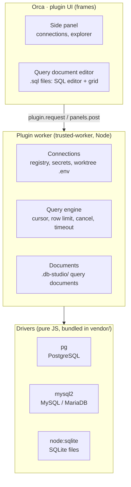

# System Architecture: DB Studio for Orca

See `PRD.md` for the product scope and requirement IDs (C1, G1, A1, ...), and `GLOSSARY.md` for terms. This document describes the MVP; the design for later versions is under [Post-MVP](#post-mvp).

## Overview

A single Orca plugin (manifest format 2). The UI runs in Orca's plugin frames; every database connection goes through a Node worker. The UI never talks to the database or a driver directly.



## Components

**UI (frames)**

- **Side panel:** saved connections, SQLite files and worktree connections, each expandable into the explorer tree (E1). Clicking a table asks the worker to open a query document for it.
- **Query document editor:** a custom editor for `.sql` files (ADR 0003). SQL editor on top (ADR 0001), query result grid below, full-value panel for a cell (G3). It reads the connection from the document's header line.

**Worker (Node)**

- **Connections:** the connection registry in `storage:own`, passwords in `secrets:own`, SQLite files by path, and worktree connections read from each worktree's `.env` on use.
- **Query engine:** runs a statement through the driver interface, reads rows from the cursor up to the row limit and the result ceiling, then closes it. Keeps the full values of the rows it returned while the query document is open (G3). Supports cancel and the `queryTimeoutSeconds` setting.
- **Documents:** creates query documents under `.db-studio/` in a workspace and opens them with `editor.open`.

## Key decisions

- **Pure-JS drivers.** The Orca directory review rejects native modules and binaries, and an installed plugin cannot carry `node_modules`. Bundle `pg` and `mysql2` into `vendor/` with esbuild; use Node's built-in `node:sqlite` for SQLite. Load each driver lazily.
- **Every tab is a file (ADR 0003).** Orca has no API for an editor tab that is not a file, and a custom editor never learns its file's path. A query document is a `.sql` file whose first line names its connection; opening a table creates one in `.db-studio/`. SQLite files are opened by path from the panel, not as a `.db` custom editor.
- **No table view.** Opening a table is a query document with `SELECT * FROM <table> LIMIT 100`. One kind of tab, one grid.
- **Row limit, no paging.** A query result is cut off at `rowLimit` (default 100), and the cursor reads `rowLimit + 1` rows to know whether it cut anything off. A statement with its own top-level `LIMIT` skips the row limit, but never the result ceiling (see [Query results](#query-results)). Paging is the person's to write.
- **No guessing the workspace.** Orca does not tell a frame which workspace it is shown in. The panel lists every connection; the person picks. Each document carries its own connection.
- **One typed contract between UI and worker.** `protocol.ts` declares the requests and pushed events, using Orca's `PluginRequests` / `PluginPanelEvents` interface merging.
- **SQL editor.** CodeMirror 6 with `@codemirror/lang-sql` dialects, bundled into `vendor/` (ADR 0001).
- **SQLite off the worker's event loop.** `node:sqlite` is synchronous, so a slow statement would freeze every tab and the panel, and no timeout or cancel could fire. The SQLite driver runs each session in a `worker_threads` thread; timeout and cancel terminate the thread.

## Query documents

The first line of a query document names its connection:

```sql
-- db-studio: connection=<ref>
SELECT * FROM "public"."users" LIMIT 100
```

- `<ref>` is a saved connection's id, a SQLite file's path, or a worktree connection (the variable plus the workspace id, since a frame cannot tell which workspace its file is in).
- A `.sql` file without the line opens as a plain SQL editor with a "Choose connection" control that writes the line.
- New documents go to `.db-studio/` in the target workspace. The worker creates `.db-studio/.gitignore` containing `*`, so the folder ignores itself and DB Studio never edits the repo's own `.gitignore`.
- Target workspace: a worktree connection's own workspace; otherwise the focused workspace when it matches exactly one entry of `workspace.list`, else a workspace picker. With no workspace open, opening a table fails with a clear error.

## Query results

A query result travels to the editor as the answer to one `plugin.request`, which Orca caps at 1 MiB and 120 s.

- **Result ceiling:** the query engine stops at 5000 rows or about 900 KB of serialized result, whichever comes first, even when the statement has its own `LIMIT`. The grid shows the same cut-off notice as for the row limit.
- **Long cells:** text is cut to 300 characters and binary values travel as a placeholder with their size (`<blob 1.2 KB>`). The full value is fetched on demand by `(row, column)` from the worker for the full-value panel (G3), capped at 1 MiB.
- **Values on the wire:** results are JSON. Integers beyond 2^53 and exact decimals travel as strings, dates as ISO strings, binary as a placeholder; duplicate column names are kept by position, not by name.
- **Full values:** each query document names itself with a `documentId` it generates. The engine keeps the returned rows' full values per document, replaces them on a re-run, drops them on `query.release` (sent when the frame closes, best effort) and keeps the 16 most recently run documents.
- **Timeout:** `queryTimeoutSeconds` (default 30) is capped at 110 so the worker answers before the request expires.

## Connections

- **Saved connection:** name, engine, host, port, database, user, options in `storage:own`; password in `secrets:own`. When `secrets.protection` is `unavailable`, saving a password fails with an error; nothing falls back to plain storage.
- **SQLite file:** Orca has no file picker. The panel lists `.db`, `.sqlite`, `.sqlite3` and `.db3` files found in each workspace (skipping `node_modules` and `.git`) and also takes a pasted absolute path. The registry keeps the path, nothing else.
- **Worktree connection:** the worker lists workspaces with `workspace.list`, reads `<path>/.env` and `<path>/.env.local` (`.env.local` wins when both define it), and looks for the `envVariable` setting (default `DATABASE_URL`). Only `postgres://`, `postgresql://` and `mysql://` URLs count. It is parsed on every use and never stored. Reading these files goes beyond what `workspace:read` describes, so the plugin description says so. Only workspaces on the local machine are read; remote ones are skipped.

## Driver interface

Every engine implements the same interface; the UI and the query engine never branch on engine type.

```ts
interface Driver {
  connect(config: ConnectionConfig, secret: string | undefined): Promise<Session>
}

interface Session {
  listObjects(): Promise<SchemaTree> // databases, schemas, tables, views
  query(sql: string, opts: QueryOptions): Promise<QueryCursor>
  cancel(queryId: string): Promise<void>
  quoteIdent(name: string): string
  close(): Promise<void>
}

interface QueryCursor {
  columns: ColumnMeta[] // empty for statements without rows
  affectedRows: number | undefined
  fetch(count: number): Promise<Row[]> // empty array = done
  close(): Promise<void>
}
```

Engine notes:

- **PostgreSQL:** `pg-cursor` (plain `pg` queries buffer the whole result); cancel via `pg_cancel_backend` from a second connection.
  - A connection runs one statement at a time, and an open cursor holds it until closed. Read anything the session needs (type names) at connect: a lookup issued after `query()` waits behind the cursor and never returns.
  - `cursor.close()` on a cursor that already finished or failed waits forever, so the driver tracks both states and skips it.
  - `statement_timeout` is the server's own limit and restarts on every batch read (each is a separate Execute), so it bounds each batch, not the whole stream. The row limit and result ceiling bound the stream.
  - The cursor's describe step is reached through pg-cursor's internal hooks (`submit`, `handleRowDescription`, `handleError`), patched by name in `src/drivers/postgres.ts`. After a `pg` or `pg-cursor` bump, run `npm run test:drivers`.
- **MySQL/MariaDB:** `mysql2` row streaming through its callback API (the promise API buffers), with `multipleStatements` off and `supportBigNumbers`/`bigNumberStrings` on; cancel via `KILL QUERY` from a second connection.
- **SQLite:** `node:sqlite` in a `worker_threads` thread, iterating rows with `statement.iterate()`; cancel and timeout terminate the thread. A connection has one thread shared by every query document using it, so cancelling or timing out one query also ends the other documents' running queries on that connection (they fail with the same cancel or timeout error); the next query starts a fresh thread (ADR 0004).

## Orca platform limits

Findings from the pinned Orca source and the 1.4.251 app; they shape the design above.

| Limit                                   | Effect                                                                               |
| --------------------------------------- | ------------------------------------------------------------------------------------ |
| Custom editors are file-only, no path   | Every tab is a file whose content says what to show (ADR 0003)                       |
| `editor.open` takes a workspace-relative path | Query documents live inside a workspace; needs `workspace:write`               |
| No plugin data directory                | Only `storage:own` (5 MiB total, 256 KiB per value, 1024 keys) for the registry      |
| `plugin.request` answer: 1 MiB, 120 s max | Result ceiling and long-cell cut-off; timeout capped at 110 s                      |
| `panels.post`: 256 KiB, 200 per 10 s    | Pushes carry change notices, never query results                                     |
| Frame → host messages: 64 KiB           | Requests from the editor carry SQL and ids only                                      |
| Whole plugin: 50 MiB, 2000 entries      | Bundle size budget for `vendor/`                                                     |
| Directory: 1 MiB per file; minified code only with its source in the repo | The build splits bundles under 1 MiB and fails above it; `vendor/` is committed next to `build/` |
| Directory: `trusted-worker` and every capability get extra review | The listing justifies the worker, `workspace:write`, `secrets:own` and the `.env` reads |
| A worker without hooks stops after 5 min idle | Sessions are reopened on the next request; nothing durable lives only in memory |
| No file picker for plugins              | SQLite files are found by scanning workspaces or pasted as a path                    |
| Worker env is whitelisted               | `DATABASE_URL` is read from `.env` / `.env.local`, never from the worker's environment              |

## Repository layout

| Path                 | Role                                                                        |
| -------------------- | --------------------------------------------------------------------------- |
| `orca-plugin.json`   | Manifest: worker, panel, query document editor, commands, settings          |
| `src/protocol.ts`    | Typed UI ↔ worker contract                                                  |
| `src/worker/`        | Worker entry, connections, query engine, documents                          |
| `src/drivers/`       | `postgres.ts`, `mysql.ts`, `sqlite.ts` + shared interface and lazy registry |
| `src/editor/`        | Query document editor: SQL editor, grid                                     |
| `src/panel/`         | Connections and explorer                                                    |
| `build/` → `vendor/` | Driver and editor bundles, license notices                                  |
| `test/`              | Driver tests against real databases + UI tests                              |

## Testing

- **Drivers:** integration tests against real PostgreSQL, MySQL and MariaDB containers (Testcontainers) plus SQLite files, in CI.
- **UI:** `orca plugin test` for components, `orca plugin check` for render scenarios, `orca plugin shot` for screenshots.
- **Manifest:** `orca plugin validate .` in CI.

## Dev loop

```
orca plugin validate .      # manifest and entries
orca plugin dev watch .     # load as dev plugin, reload on save
orca plugin types .         # generate .orca/types
orca plugin test .          # *.test.ts(x) with orca/testing
orca plugin check .         # render check scenarios
orca plugin shot <key>      # PNG screenshot
```

## Post-MVP

Design notes kept for later versions. They are not built in the MVP and may change when their version starts.

**Agents over MCP (v1: A1, A2, A4)**

- A plain Node stdio MCP server with no dependencies, shipped in `mcp/`, talking to a loopback-only HTTP gateway in the worker.
- `agent.launch.before` can only rewrite `command` and add `env` (64 variables, 2 s deadline), and its payload has `workspaceId` but no path or MCP field. Injection is an adapter per agent CLI: `claude` gets `--mcp-config`, `codex` gets `-c mcp_servers...`; other agents pass untouched.
- The MCP server runs with the worker's `process.execPath` and `ELECTRON_RUN_AS_NODE=1`, so it does not need `node` on the person's `PATH`.
- A token per agent launch, bound to `{workspaceId, agent}`, tells the gateway which agent and worktree sent each query: it picks the right worktree connection and records the origin.
- A worker restart invalidates running agents' tokens; the agent gets a clear error. Restored sessions are not hooked.
- Read-only is enforced by the database session (`BEGIN READ ONLY` / `START TRANSACTION READ ONLY` / read-only SQLite connection), one statement per agent call, and a snapshot taken before the agent's SQL in PostgreSQL. Bypass tests cover writes in CTEs and functions, multi-statement batches, `SET TRANSACTION READ WRITE` and `COMMIT; ...`. `dblink` and similar are only covered by a separate low-privilege agent credential.
- `run_query` returns 100 rows by default and 1000 at most, truncates long values, and says when it cut anything off.
- Activity log in a `node:sqlite` file under `$HOME`, since `storage:own` is too small; SQL and metadata only, never row data.

**Writes and grid (v2: A3, D1, D2, G6)**

- On a `read-write` connection, an agent query first runs read-only; only a read-only violation from the database queues it for approval.
- A paged, virtualized grid for large query results.
